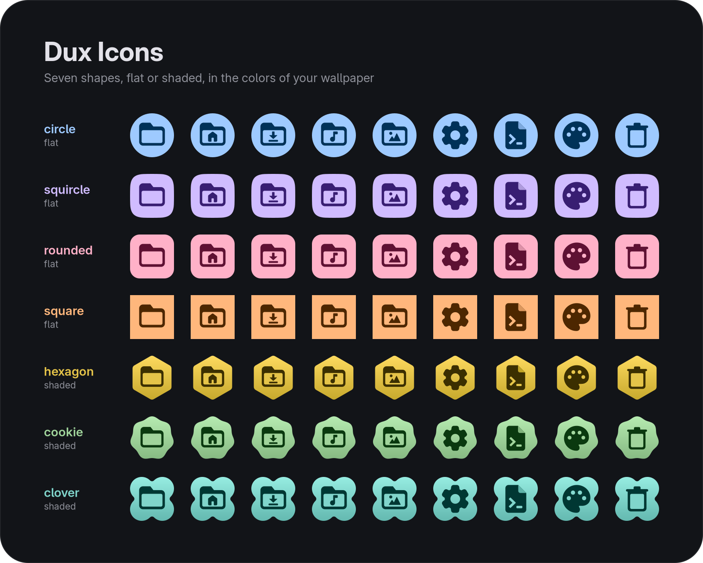

# Dux Icons

<div align="center">
  <a href="https://duxlabs.dev">
    <picture>
      <source media="(prefers-color-scheme: light)" srcset="assets/dux-logo-light.svg">
      
    </picture>
  </a>

### An icon theme that follows your colors

Built for [DMS](https://github.com/duxlabs-dev/dux-shell), works on any freedesktop desktop

<picture>
  <source media="(prefers-color-scheme: light)" srcset="assets/hero-light.png">
  
</picture>

</div>

Dux Icons is a generated icon theme. It puts each app's own icon on a Material badge, draws folders and file types itself, and paints all of it from your current Material colors. Change the wallpaper and the icons change with it.

It is a generator, not a hand-drawn app set. Your apps keep the artwork their authors shipped; Dux Icons supplies the frame and the color.

## Features

**Your apps, one shape**
Every installed app with a `.desktop` entry gets its own icon framed on the same badge. Nothing is redrawn, so a new app looks right the day you install it.

**Follows your theme**
Badge, folders and file types take Material `primary` and `on_primary`. With DMS they repaint on every wallpaper or theme change. Without DMS you pass the colors yourself.

**Folders and file types**
Folders, the home and XDG user folders, trash, network places and the common file types are drawn for the theme and use the same colors.

**Monochrome mode**
Paint app icons in tones of your theme colors instead of keeping their own.

**A normal icon theme**
The output is a standard freedesktop theme of scalable SVGs. GTK, Qt and KDE apps can all use it, and any name it does not provide falls back to `hicolor`.

## Installation

You need Python 3.9 or newer. There is nothing else to install, and nothing needs root.

```bash
git clone https://github.com/duxlabs-dev/dux-icons.git
cd dux-icons
make install
```

This installs the `dux-icons` command into `~/.local/bin`. `make uninstall` removes it.

### With DMS

Pick **Dux Icons** under Settings → Appearance → Icons. DMS builds the theme and rebuilds it on every wallpaper or theme change, when an app is installed or removed, and when the shell starts. The same card has three options: **Icon shape** picks the badge outline, **Themed app icons** paints app icons in your colors, and **Shaded icons** fills the badges with a soft gradient.

From a terminal:

```bash
dms ipc call settings set iconThemeDark dux-icons
dms ipc call settings set iconMonoApps true
dms ipc call settings set iconShape squircle
dms ipc call settings set iconGradient true
```

DMS can also match the folders of other icon themes (Papirus, Breeze, Adwaita, Tela, Colloid) to your colors, and plugins can add more themes. That is a DMS feature and does not need Dux Icons; see [Icon Theming](https://duxlabs.dev/docs/dms/icon-theming) in the DMS docs.

### Without DMS

Give it the two colors:

```bash
dux-icons --badge '#9ecaff' --glyph '#003258'
```

This builds the theme into `~/.local/share/icons/dux-icons`; desktops list it as **Dux Icons** in their icon theme setting. Run it again after installing or removing apps. Each run replaces the previous theme in one step, so nothing is ever half written.

## Usage

```bash
dux-icons --from-dms              # colors from the running DMS theme
dux-icons --from-dms --mode light # use the light scheme
dux-icons --from-dms --mono       # app icons in your colors
dux-icons --from-dms --shape squircle --gradient
dux-icons --palette colors.json   # colors from a file
dux-icons --out DIR --name NAME   # build somewhere else, under another name
```

From a checkout without installing, `python3 scripts/build.py` takes the same options.

| option | does |
| --- | --- |
| `--from-dms` | read colors from DMS |
| `--mode dark\|light` | which scheme to read, default follows DMS |
| `--badge HEX` | badge and folder front color |
| `--glyph HEX` | color of marks drawn on the badge |
| `--back HEX` | folder back color, default is a darker `--badge` |
| `--mono`, `--no-mono` | paint app icons in tones of your colors, or keep their own |
| `--shape NAME` | badge shape: `circle`, `squircle`, `rounded`, `square`, `hexagon`, `cookie` or `clover` |
| `--gradient`, `--no-gradient` | shade the badge from lighter at the top to darker at the bottom, or keep it flat |
| `--palette FILE` | JSON file with `badge` and `glyph` |
| `--out DIR` | where to write the theme |
| `--name NAME` | theme name written to `index.theme` |
| `-v` | list every icon that was skipped, with the reason |

The build only writes to a directory it created itself, and refuses a symlink or a folder with other files in it.

## How it works

`src/recipe.json` controls the build:

- `template`: the default badge shape, a file in `src/templates/`
- `shapes`: layout changes a shape needs, such as more padding inside a hexagon
- `gradient`: `true` shades the badge
- `vendorThemes`: installed icon themes searched, in order, for an `Icon=` name the app did not install itself
- `mono`: `false` keeps app colors, `true` paints them in tones between `@glyph` and `@back`
- `monoContrast`: how hard `mono` pushes tones apart; `1` leaves them as they are
- `tokens`: the Material roles behind `@badge`, `@glyph` and optionally `@back`
- `layout`: how far content sits inside the badge
- `overrides`: layout changes for icons matching a name pattern
- `inherits`: the themes used for anything Dux Icons does not provide

Vector icons are placed into the badge as vectors. Bitmap icons are embedded, so the result is always a single self-contained SVG. An icon that cannot be placed cleanly is skipped and falls back to `hicolor`; the build prints how many and why.

Monochrome mode and clipping of oversized artwork need Qt 6.7 or newer in Qt apps.

## Drawing an icon

Own icons live in `src/own/<context>/<name>.svg`.

- Draw on a `0 0 24 24` viewBox, without the badge.
- Use only the tokens `@glyph`, `@badge` and `@back` as colors.
- If several icon names share the picture, list them in `src/aliases.json` instead of copying the file.

## Development

```bash
python3 -m unittest
```

## Credits

Type marks on folders and file types are adapted from [Material Symbols](https://github.com/google/material-design-icons), Apache-2.0. See [NOTICE](NOTICE).

## License

[MIT](LICENSE)
