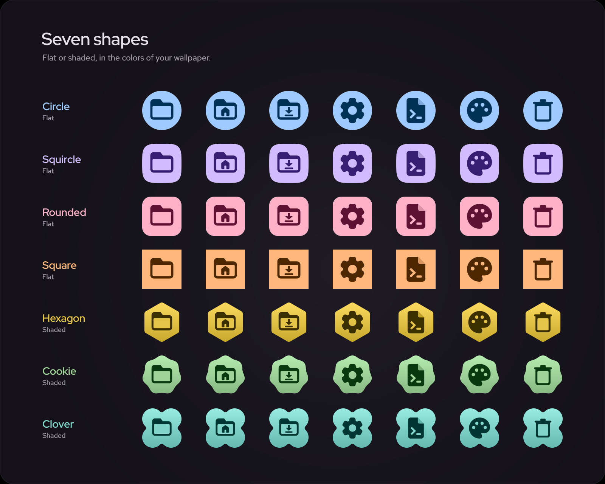
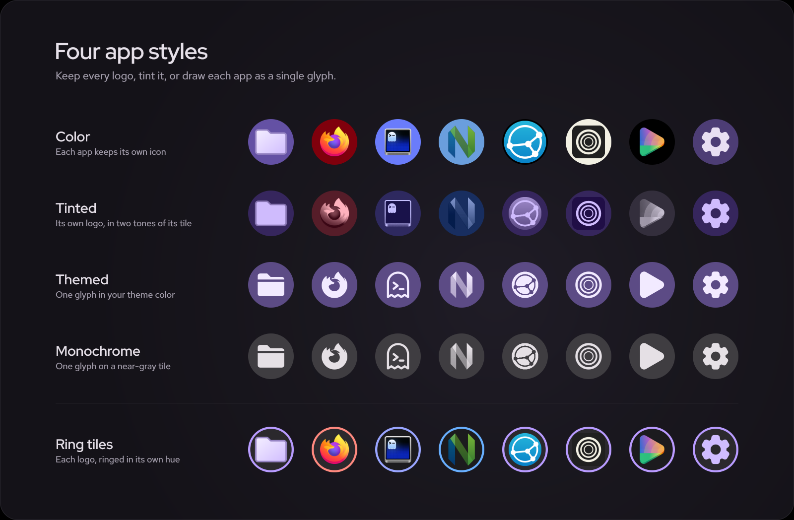

# Dux Icons

<div align="center">
  <a href="https://duxlabs.dev">
    <picture>
      <source media="(prefers-color-scheme: light)" srcset="assets/dux-logo-light.svg">
      
    </picture>
  </a>

### An icon theme that follows your colors

Built for [DMS](https://github.com/duxlabs-dev/dux-shell), works on any freedesktop desktop

<picture>
  <source media="(prefers-color-scheme: light)" srcset="assets/hero-light.png">
  
</picture>

</div>

Dux Icons is a generated icon theme. It puts each app's own icon on a Material tile, draws folders and file types itself, and paints all of it from your current Material colors. Change the wallpaper and the icons change with it.

It is a generator, not a hand-drawn app set. Your apps keep the artwork their authors shipped; Dux Icons supplies the frame and the color.

## Features

**Your apps, one shape**
Every installed app with a `.desktop` entry gets its own icon framed on the same tile. Nothing is redrawn, so a new app looks right the day you install it.

**Follows your theme**
Tiles, folders and file types take Material `primary` and `on_primary`. With DMS they repaint on every wallpaper or theme change. Without DMS you pass the colors yourself.

<picture>
  <source media="(prefers-color-scheme: light)" srcset="assets/shapes-light.png">
  
</picture>

**Folders and file types**
Folders, the home and XDG user folders, trash, network places and the common file types are drawn for the theme and use the same colors: on the tile like your apps (Standard), or as full-color folders and documents with each file type in its own hue (Color).

**App icon styles**
Keep each app's own artwork (Color), repaint it in two tones of its tile (Tinted), or draw every app as a one-color glyph on a tile in your theme hue (Themed) or in near-neutral gray (Monochrome). Glyphs come from the app's own symbolic icon where it ships one, from a symbolic icon of an icon theme you have installed, or from the app's icon with its backing plate removed.

<picture>
  <source media="(prefers-color-scheme: light)" srcset="assets/styles-light.png">
  
</picture>

**A normal icon theme**
The output is a standard freedesktop theme of scalable SVGs. GTK, Qt and KDE apps can all use it, and any name it does not provide falls back to `hicolor`.

## Installation

Dux Icons is packaged as `dux-icons` for Arch (AUR), Fedora and CentOS (Copr), Debian and openSUSE (OBS), Ubuntu (PPA) and Void. Add the [Dux Labs repository](https://duxlabs.dev/docs/repo/) for your distribution and install it:

```bash
paru -S dux-icons                # Arch
sudo dnf install dux-icons       # Fedora, after enabling the duxlabs/dux-repo Copr
sudo apt install dux-icons       # Debian and Ubuntu
sudo zypper install dux-icons    # openSUSE
sudo xbps-install -S dux-icons   # Void
```

From source, you need Python 3.9 or newer and nothing else:

```bash
git clone https://github.com/duxlabs-dev/dux-icons.git
cd dux-icons
make install
```

## Usage

With DMS, pick **Dux Icons** under Settings → Appearance → Icons. DMS rebuilds the theme on every wallpaper or theme change.

Without DMS, give it your two colors. The theme is built into `~/.local/share/icons/dux-icons`:

```bash
dux-icons --tile '#9ecaff' --glyph '#003258'
```

Options, tile shapes, the build recipe and drawing your own icons are covered in the [Dux Icons documentation](https://duxlabs.dev/docs/dicons/).

## Development

```bash
python3 -m unittest
```

## Credits

Type marks on folders and file types are adapted from [Material Symbols](https://github.com/google/material-design-icons), Apache-2.0. See [NOTICE](NOTICE).

In the Themed and Monochrome styles, many app glyphs come from icon themes already on your system, such as [Papirus](https://github.com/PapirusDevelopmentTeam/papirus-icon-theme), [Adwaita](https://gitlab.gnome.org/GNOME/adwaita-icon-theme) and [Breeze](https://invent.kde.org/frameworks/breeze-icons), and from the symbolic icons apps ship themselves. Thank you to their authors. Dux Icons reads them at build time on your machine and never bundles them; they keep their own licenses.

## License

[MIT](LICENSE)
